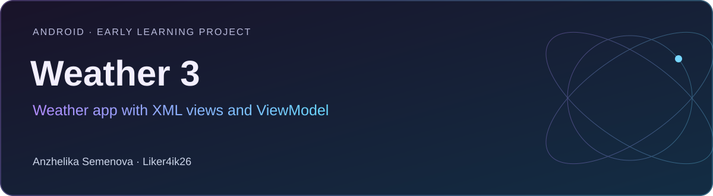

# Weather 3

**Android · Early learning project** · Kotlin · Android Views / XML · ViewModel · LiveData · Retrofit · Glide

Ранний учебный проект погодного приложения на классическом Android UI: ввод города, запрос погоды и сохранение последнего выбора.

[Портфолио автора](https://portfolio.semenova-anzhelika.online/) · [Профиль GitHub](https://github.com/Liker4ik26) · [Исходники](https://github.com/Liker4ik26/weather3/tree/main)

## Что в проекте

- Ввод города и обновление погодных данных.
- ViewModel и LiveData для обновления интерфейса.
- Сохранение выбранного города в SharedPreferences.
- XML-разметка, View Binding и изображения через Glide.

## Технологии

| Направление | Реализация |
| :--- | :--- |
| Стек | Kotlin · Android Views / XML · ViewModel · LiveData · Retrofit · Glide |
| Формат | Android · Early learning project |
| Окружение | Android Studio и JDK, совместимый с Gradle проекта |

## Где смотреть код

- weather30/app/src/main/java/com/example/weather30/view/ — Activity
- weather30/app/src/main/java/com/example/weather30/viewmodel/ — состояния
- weather30/app/src/main/java/com/example/weather30/service/ — API

## Как запустить

Требования: Android Studio и JDK, совместимый с Gradle проекта.

```bash
git clone --branch main https://github.com/Liker4ik26/weather3.git
cd weather3
```

Откройте каталог `weather30` в Android Studio, выполните Gradle Sync и выберите Android-эмулятор или устройство. Для сборки из терминала:

```bash
cd weather30
bash gradlew :app:assembleDebug
```

Проект использует внешний погодный API. Подготовьте собственные параметры доступа; не полагайтесь на старую демонстрационную конфигурацию.

## English overview

**Weather 3 — Weather app with XML views and ViewModel.**

Android · Early learning project. Stack: Kotlin · Android Views / XML · ViewModel · LiveData · Retrofit · Glide. [Explore my professional portfolio](https://portfolio.semenova-anzhelika.online/).

---

**Автор — Анжелика Семёнова · [Liker4ik26](https://github.com/Liker4ik26)**

[Сайт](https://portfolio.semenova-anzhelika.online/) · [Telegram](https://t.me/Liker4ik50) · [Почта](mailto:pr110oat18@gmail.com)
